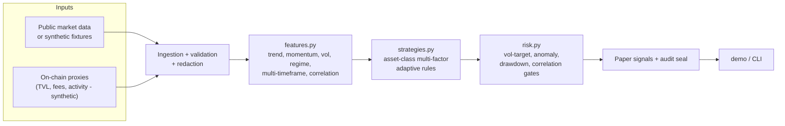

# Architecture (v4)

## High-level data flow

## Process harness
Inspired by zeekiankok92:
- Task briefs with acceptance criteria
- AGENTS.md rules
- CI gates (lint, tests, secret scan, license)
- Human review + disclosure log
- Definition of Done = CI green + human sign-off

## Design choices
- Stdlib-preferring core for small attack surface.
- Injectable I/O for offline tests.
- Deterministic strategy stubs that are easily extended.
- Explicit paper-only constraint enforced in code comments and runtime checks.
